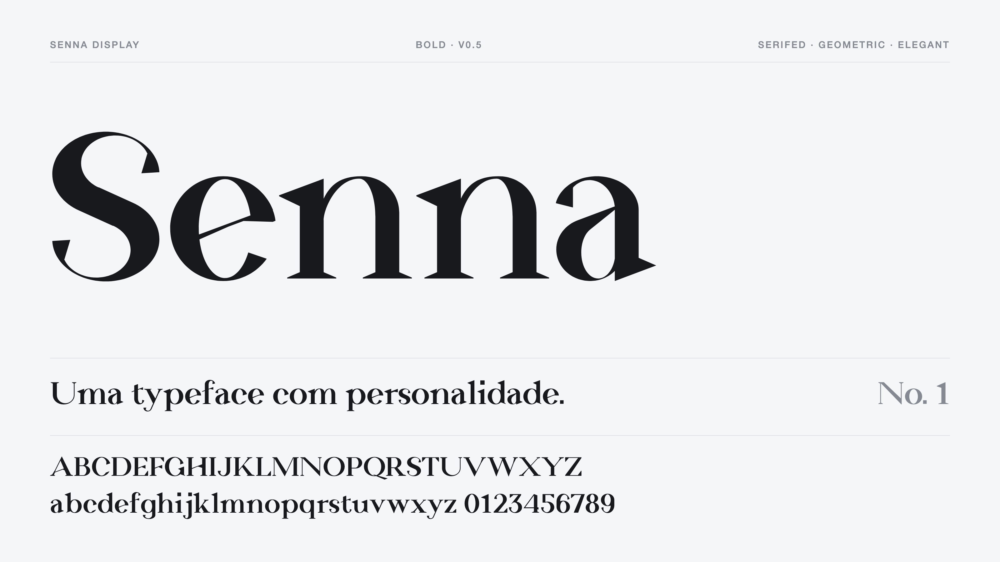

<p align="center">
  
</p>

# Senna Display

**Senna Display** is my first typeface: a serifed, geometric and elegant
display face made for headlines. It is called Senna because it has a lot of
personality: hairlines that almost disappear next to heavy stems, hard
wedge serifs, and stroke ends that swell into sharp pressure wedges.

- **Serifed.** Triangular wedge serifs and straight diagonal stem cuts, no
  brackets, no soft corners.
- **Geometric.** Every curve is a true ellipse; everything else is a straight
  line. Bowls, arches and spines are built from the same few parts.
- **Elegant.** Very high contrast, a large x-height and tight spacing, so it
  reads best big: titles, covers, posters, wordmarks.

The whole font is defined in Python, glyph by glyph, and built into OTF and
WOFF2. The feel is inspired by geometric display serifs like the headline
faces on tako.ai, but every outline here is original.

> **Status:** v0.5, two styles: Bold and Medium. A variable version is planned.

## Project layout

- `font/params.py`: the shared design settings (metrics, stem weights, serif shape, spacing). Start here. `STYLES` sets each style's stem weights; everything else is shared.
- `font/draw.py`: drawing primitives (contours, ellipses, boolean union/cut).
- `font/parts.py`: reusable letter parts (serifs, arches, bowls, pen-angle bars and cuts, the broad-nib `nib_stroke`).
- `font/glyphs.py`: one function per glyph.
- `font/kerning.py`: optical kerning measured from the outlines (band-by-band closeness, with a collision guard), written to the `kern` feature at build time. `STRENGTH` and `LIMIT` set how hard it pulls.
- `build.py`: draws every glyph for each style and writes `dist/SennaDisplay-Bold.*` and `dist/SennaDisplay-Medium.*` (OTF and WOFF2).
- `specimen/index.html`: specimen page.
- `specimen/readme-card.html`: the image at the top of this README; `python3 specimen/render_card.py` re-renders it to `docs/senna-display-v2.png` with headless Chrome.
- `specimen/proof.html?t=nohO&s=300`: big close-up proof (add `&w=500` for Medium).

## Build and preview

```bash
python3 -m venv .venv && .venv/bin/pip install -r requirements.txt
.venv/bin/python build.py
python3 -m http.server 8765
```

Then open http://127.0.0.1:8765/specimen/.

After a rebuild, refresh the README image:

```bash
python3 specimen/render_card.py
```

## Use on a website

```css
@font-face {
  font-family: "Senna Display";
  src: url("/fonts/SennaDisplay-Bold.woff2") format("woff2");
  font-weight: 700;
  font-display: swap;
}
@font-face {
  font-family: "Senna Display";
  src: url("/fonts/SennaDisplay-Medium.woff2") format("woff2");
  font-weight: 500;
  font-display: swap;
}
h1 { font-family: "Senna Display", Georgia, serif; font-weight: 700; letter-spacing: -0.01em; }
h2 { font-family: "Senna Display", Georgia, serif; font-weight: 500; }
```

## Glyph set (v0.5)

- Lowercase: the full alphabet, `a` to `z`.
- Capitals: the full alphabet, `A` to `Z`.
- Figures: lining `0` to `9` at cap height, built from the capitals' parts.
- Portuguese: `á à â ã é ê í ó ô õ ú ü ç` and their capitals.
- Punctuation: `. ,` and space.

## How it is drawn

The strokes follow a brush: each one starts thin and ends with pressure,
except straight vertical stems, which keep one weight. Curves are true
ellipses inside and out: rings (an ellipse minus a counter), ellipses run off
along straight pen-angle tangents into stems, and bowls joined by straight
spines tangent to both (s, S). Where a curved stroke starts it is cut thin on
the shared pen angle (`PEN`), as at the foot of c, e and C; where it ends it
swells into a sharp pressure wedge, the curved twin of the crossbars' tip: a
flat face cut square across the stroke, its inner side widening toward it in
a straight line (a, c, f, g, j, s, t, y, C, G, J, S), all from one helper,
`_tear_end`. The Q's tail and the comma are straight tapered strokes. Straight strokes follow the
same order: crossbars start as a hairline on the left and end in a heavy
right tip (`BAR_FLARE`, `BAR_TIP`); thick diagonals are written downward,
narrow at the top and heavier at the bottom (`DIAG_TAPER`), reversed in the
A, whose legs start at the apex; thin diagonals swell only at the end they
finish on. Thin verticals (N, M, U) keep one weight.

Everything that is not a curve is drawn in straight lines: serifs are
triangular wedges, stem heads are straight diagonal cuts, flares are straight
tapers and dots are squares.

The a is the model for the weights in `params.py`. Curves run heavier than
stems so they read equally dark: `ROUND` (119) for lowercase, `CAP_ROUND`
(125) for capitals. Thin strokes are `THIN` (11) and `CAP_THIN` (12), with
bowls a little firmer (`O_THIN`) and crossbars and arms firmer still
(`BAR_THIN`, `CAP_BAR_THIN`), since a long hairline reads lighter than a short
one. Change any of them to shift that part of the whole alphabet.
